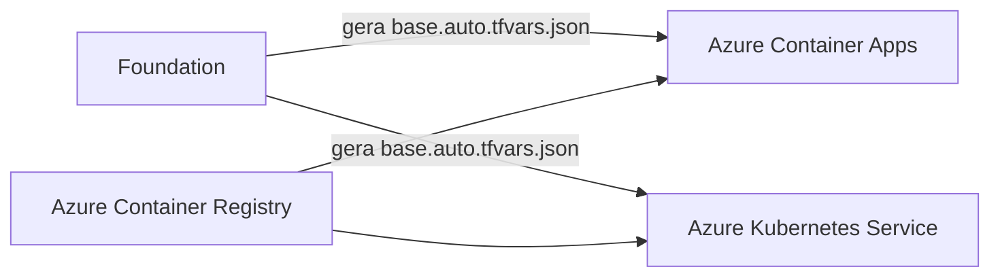

# Azure Functions em Azure Container Apps e Azure Kubernetes Service

Este projeto demonstra como executar aplicações Azure Functions empacotadas
como containers em dois destinos:

- **Azure Container Apps (ACA)**;
- **Azure Kubernetes Service (AKS)**.

O objetivo é comparar a infraestrutura, o processo de implantação e as
dependências necessárias para executar a mesma ideia de Function nos dois
ambientes.

O módulo `foundation` fornece a infraestrutura compartilhada e deve ser
implantado primeiro. Depois dele, escolha uma das opções:

- implantar somente o cenário Azure Container Apps;
- implantar somente o cenário Azure Kubernetes Service;
- implantar os dois cenários para comparação.

Os módulos `aca` e `aks` são independentes entre si e mantêm states separados.
No cenário AKS, o Terraform provisiona a infraestrutura e renderiza os
manifests; a aplicação dos objetos Kubernetes é executada separadamente com
`kubectl`.

## Arquitetura

O projeto usa três raízes Terraform independentes, cada uma com seu próprio
state:



O módulo `foundation` cria os recursos compartilhados:

- Resource Group;
- Virtual Network;
- Network Security Group;
- subnets para hosts, PostgreSQL, Azure Container Apps e AKS;
- Storage Account;
- Azure Key Vault;
- Azure Service Bus namespace e queue;
- Azure Container Registry;
- duas User Assigned Managed Identities;
- permissões RBAC para as aplicações producer e consumer.

Depois do deploy, o módulo gera dois arquivos de handoff:

- `aca/base.auto.tfvars.json`;
- `aks/base.auto.tfvars.json`.

Os handoffs contêm nomes, IDs, endpoints e metadados não secretos. Chaves,
senhas e connection strings não são gravadas nesses arquivos.

## Estrutura do projeto

```text
ContainerFunction/
├── .gitignore
├── README.md
├── foundation/
│   ├── container-registry.tf
│   ├── handoff.tf
│   ├── identities.tf
│   ├── key-vault.tf
│   ├── naming.tf
│   ├── network.tf
│   ├── providers.tf
│   ├── resource-group.tf
│   ├── role-assignments.tf
│   ├── service-bus.tf
│   ├── storage.tf
│   ├── terraform.tfvars
│   ├── variables.tf
│   └── versions.tf
├── aca/
│   ├── base.auto.tfvars.json
│   ├── consumer.tf
│   ├── environment.tf
│   ├── naming.tf
│   ├── producer.tf
│   ├── providers.tf
│   ├── terraform.tfvars
│   ├── variables.tf
│   └── versions.tf
├── aks/
│   ├── base.auto.tfvars.json
│   ├── cluster.tf
│   ├── federation.tf
│   ├── identities.tf
│   ├── manifests.tf
│   ├── naming.tf
│   ├── providers.tf
│   ├── role-assignments.tf
│   ├── terraform.tfvars
│   ├── variables.tf
│   └── versions.tf
└── k8s/
    ├── yaml/
    │   ├── 00-namespace.yaml.tftpl
    │   ├── 10-producer.yaml.tftpl
    │   ├── 20-consumer.yaml.tftpl
    │   └── 21-consumer-keda.yaml.tftpl
    └── rendered/
        └── .gitkeep
```

Os arquivos `terraform.tfvars`, `*.auto.tfvars.json`, states, planos e o
diretório `.terraform/` são ignorados pelo Git.

## Pré-requisitos

Os comandos deste guia consideram Windows com WSL 2. Execute Terraform, Azure
CLI, `kubectl` e os demais comandos Linux dentro do WSL.

Ferramentas necessárias:

- WSL 2 com uma distribuição Linux, como Ubuntu;
- Terraform `>= 1.16.4, < 2.0.0`;
- Azure CLI;
- `jq`;
- `kubectl`;
- uma assinatura Azure ativa;
- permissão para criar recursos na assinatura.

Os providers configurados são:

- `hashicorp/azurerm` 5.x;
- `Azure/azapi` 2.x;
- `hashicorp/random` 3.x;
- `hashicorp/local` 2.x.

### Verificar o ambiente

No Windows, abra o WSL:

```powershell
wsl
```

No terminal Linux, verifique as ferramentas:

```bash
terraform version
az version
jq --version
```

Caso o Azure CLI ainda não esteja instalado no WSL, consulte a documentação
oficial ou use o instalador para distribuições Debian/Ubuntu:

```bash
curl -sL https://aka.ms/InstallAzureCLIDeb | sudo bash
```

Para instalar o Terraform, siga as instruções do repositório oficial da
HashiCorp para a distribuição Linux utilizada:

<https://developer.hashicorp.com/terraform/install>

## Autenticação no Azure

Autentique o Azure CLI dentro do WSL:

```bash
az login
```

Se a assinatura estiver em outro tenant:

```bash
az login --tenant <TENANT_ID>
```

Liste as assinaturas disponíveis:

```bash
az account list --output table
```

Selecione a assinatura usada pelo projeto:

```bash
az account set --subscription <SUBSCRIPTION_ID>
az account show --output table
```

O `subscription_id` informado ao Terraform deve ser o mesmo selecionado no
Azure CLI.

## Configurar o módulo foundation

Acesse a raiz do projeto no local em que o repositório foi clonado. O caminho
depende de onde cada usuário executou o `git clone`:

```bash
cd <CAMINHO_LOCAL_DO_REPOSITORIO>/ContainerFunction
```

Os exemplos restantes assumem que o diretório atual é a raiz
`ContainerFunction`. Crie `foundation/terraform.tfvars` com os valores do
ambiente. O exemplo abaixo apresenta a configuração base do cenário:

```hcl
azure = {
  subscription_id     = "<SUBSCRIPTION_ID>"
  resource_group_name = "rg-azlab"
  location            = "centralus"
}

naming = {
  base_prefix        = "a"
  random_length      = 13
  key_vault_prefix   = "kv-"
  service_bus_prefix = "sb-"
}

managed_identities = {
  producer = {
    name_prefix = "sp-producer-"
  }

  consumer = {
    name_prefix = "sp-consumer-"
  }
}

rbac = {
  acr_pull_role_name                      = "AcrPull"
  storage_blob_data_role_name             = "Storage Blob Data Owner"
  storage_queue_data_role_name            = "Storage Queue Data Contributor"
  storage_table_data_role_name            = "Storage Table Data Contributor"
  service_bus_data_sender_role_name       = "Azure Service Bus Data Sender"
  service_bus_data_receiver_role_name     = "Azure Service Bus Data Receiver"
}

network = {
  vnet_name     = "lab-azvnet"
  address_space = ["10.160.0.0/20"]
  nsg_name      = "nsg-azhosts"

  subnets = {
    azhosts = {
      name           = "azhosts"
      address_prefix = "10.160.0.0/27"
    }

    pgsqlnet = {
      name           = "pgsqlnet"
      address_prefix = "10.160.0.64/26"
    }

    acasubnet = {
      name           = "acasubnet"
      address_prefix = "10.160.5.0/24"
    }

    worker_aks = {
      name           = "worker-aks"
      address_prefix = "10.160.3.0/24"
    }
  }
}

storage = {
  sku_name                  = "Standard_LRS"
  min_tls_version           = "TLS1_2"
  shared_access_key_enabled = true
}

key_vault = {
  sku_name                   = "standard"
  rbac_authorization_enabled = true
  retention_days             = 7
}

service_bus = {
  sku                           = "Standard"
  public_network_access_enabled = true
  queue_name                    = "data"
}

container_registry = {
  sku                                 = "Basic"
  admin_enabled                       = false
  arm_audience_authentication_enabled = true
}
```

Os nomes do Storage Account e do Azure Container Registry usam o mesmo nome
base aleatório. O Key Vault e o Service Bus adicionam seus respectivos
prefixos. O valor aleatório é mantido no state e não muda entre execuções.

## Identidades e RBAC

O `foundation` cria duas User Assigned Managed Identities:

- `sp-producer-<base_name>` para a Function HTTP que envia mensagens;
- `sp-consumer-<base_name>` para a Function acionada pelo Azure Service Bus.

As identidades são reutilizadas nos módulos ACA e AKS. O handoff fornece
`id`, `client_id` e `principal_id` de cada identidade.

| Identidade | Papel | Escopo |
| --- | --- | --- |
| producer | `AcrPull` | Azure Container Registry |
| producer | `Storage Blob Data Owner` | Storage Account |
| producer | `Storage Queue Data Contributor` | Storage Account |
| producer | `Storage Table Data Contributor` | Storage Account |
| producer | `Azure Service Bus Data Sender` | queue `data` |
| consumer | `AcrPull` | Azure Container Registry |
| consumer | `Storage Blob Data Owner` | Storage Account |
| consumer | `Storage Queue Data Contributor` | Storage Account |
| consumer | `Storage Table Data Contributor` | Storage Account |
| consumer | `Azure Service Bus Data Receiver` | queue `data` |

Os papéis do Azure Service Bus são aplicados na fila específica, e não no
namespace. Nenhum papel é aplicado no escopo da subscription ou do Resource
Group.

No Azure Container Apps, as UAMIs também podem autorizar o pull das imagens.
No AKS, o pull acontece antes de o pod iniciar. Por isso, Workload Identity não
substitui a permissão `AcrPull` da identidade kubelet/node pool configurada no
módulo AKS.

## Build das imagens das Functions

O código das duas Functions está em:

```text
code/
├── HttpTrigerProcuder/
└── ServiceBusConsumerFunction/
```

Os nomes padronizados das imagens são:

| Aplicação | Repositório da imagem | Tag inicial |
| --- | --- | --- |
| HTTP trigger producer | `function-http-producer` | `v1` |
| Service Bus consumer | `function-servicebus-consumer` | `v1` |

Os módulos ACA e AKS devem usar os mesmos nomes:

```text
<acr-login-server>/function-http-producer:v1
<acr-login-server>/function-servicebus-consumer:v1
```

Execute os comandos a partir do WSL:

```bash
cd <CAMINHO_LOCAL_DO_REPOSITORIO>/ContainerFunction

ACR_NAME=$(terraform -chdir=./foundation output -json handoff |
  jq -r '.container_registry.name')

ACR_LOGIN_SERVER=$(terraform -chdir=./foundation output -json handoff |
  jq -r '.container_registry.login_server')

IMAGE_TAG="v1"
```

### Opção 1: build local com Docker Desktop

Confirme que o Docker Desktop está disponível no WSL:

```bash
docker version
docker context show
```

Faça o build das imagens:

```bash
docker build \
  --tag "function-http-producer:${IMAGE_TAG}" \
  ./code/HttpTrigerProcuder

docker build \
  --tag "function-servicebus-consumer:${IMAGE_TAG}" \
  ./code/ServiceBusConsumerFunction
```

Verifique as imagens locais:

```bash
docker image inspect \
  "function-http-producer:${IMAGE_TAG}" \
  "function-servicebus-consumer:${IMAGE_TAG}" \
  --format '{{index .RepoTags 0}} | {{.Os}}/{{.Architecture}} | {{.Size}} bytes'
```

Autentique o Docker no ACR usando o Azure CLI:

```bash
az acr login --name "$ACR_NAME"
```

Adicione os nomes completos do registry:

```bash
docker tag \
  "function-http-producer:${IMAGE_TAG}" \
  "${ACR_LOGIN_SERVER}/function-http-producer:${IMAGE_TAG}"

docker tag \
  "function-servicebus-consumer:${IMAGE_TAG}" \
  "${ACR_LOGIN_SERVER}/function-servicebus-consumer:${IMAGE_TAG}"
```

Envie as imagens:

```bash
docker push "${ACR_LOGIN_SERVER}/function-http-producer:${IMAGE_TAG}"
docker push "${ACR_LOGIN_SERVER}/function-servicebus-consumer:${IMAGE_TAG}"
```

### Opção 2: build remoto direto no ACR

Esta opção envia o contexto de build para o Azure Container Registry. Ela não
depende do Docker Desktop e não cria uma imagem no cache local.

Confirme a autenticação e a assinatura antes de iniciar:

```bash
az account show --output table
```

Execute os builds remotos com o Azure CLI:

```bash
az acr build \
  --registry "$ACR_NAME" \
  --image "function-http-producer:${IMAGE_TAG}" \
  ./code/HttpTrigerProcuder

az acr build \
  --registry "$ACR_NAME" \
  --image "function-servicebus-consumer:${IMAGE_TAG}" \
  ./code/ServiceBusConsumerFunction
```

O comando `az acr build` faz o build e publica a imagem no ACR em uma única
operação.

### Verificar as imagens no ACR

Liste os repositórios:

```bash
az acr repository list \
  --name "$ACR_NAME" \
  --output table
```

Liste as tags de cada imagem:

```bash
az acr repository show-tags \
  --name "$ACR_NAME" \
  --repository function-http-producer \
  --output table

az acr repository show-tags \
  --name "$ACR_NAME" \
  --repository function-servicebus-consumer \
  --output table
```

Consulte o digest consumido pelos módulos ACA e AKS:

```bash
az acr repository show \
  --name "$ACR_NAME" \
  --image "function-http-producer:${IMAGE_TAG}" \
  --query '{image:name,digest:digest,lastUpdateTime:lastUpdateTime}' \
  --output yaml

az acr repository show \
  --name "$ACR_NAME" \
  --image "function-servicebus-consumer:${IMAGE_TAG}" \
  --query '{image:name,digest:digest,lastUpdateTime:lastUpdateTime}' \
  --output yaml
```

Para este cenário, a tag `v1` é suficiente. Em pipelines ou ambientes
compartilhados, prefira uma tag imutável, como o SHA do commit, e use o digest
da imagem no deploy.

## Validar e implantar o foundation

Inicialize o diretório:

```bash
terraform -chdir=./foundation init
```

Valide formatação e configuração:

```bash
terraform -chdir=./foundation fmt -check
terraform -chdir=./foundation validate
```

Gere e revise um plano:

```bash
terraform -chdir=./foundation plan -out=foundation.tfplan
```

Implante exatamente o plano revisado:

```bash
terraform -chdir=./foundation apply foundation.tfplan
```

Após o deploy, consulte os outputs:

```bash
terraform -chdir=./foundation output
terraform -chdir=./foundation output -json handoff | jq
```

O apply cria automaticamente:

```text
../aca/base.auto.tfvars.json
../aks/base.auto.tfvars.json
```

Não edite esses arquivos manualmente. Eles são artefatos gerados pelo módulo
`foundation` e serão substituídos em um novo apply.

## Validar o deploy

Um segundo plan deve ser idempotente:

```bash
terraform -chdir=./foundation plan
```

Resultado esperado:

```text
No changes. Your infrastructure matches the configuration.
```

Verifique a delegação da subnet do Azure Container Apps:

```bash
az network vnet subnet show \
  --resource-group rg-azlab \
  --vnet-name lab-azvnet \
  --name acasubnet \
  --query "delegations[0].serviceName" \
  --output tsv
```

Resultado esperado:

```text
Microsoft.App/environments
```

Verifique se o Azure Container Registry aceita tokens ARM:

```bash
ACR_NAME=$(terraform output -json handoff | jq -r '.container_registry.name')

az acr config authentication-as-arm show \
  --registry "$ACR_NAME" \
  --query status \
  --output tsv
```

Resultado esperado:

```text
enabled
```

## Implantar as Functions no Azure Container Apps

O módulo `aca` usa state próprio e lê automaticamente o handoff
`aca/base.auto.tfvars.json` gerado pelo `foundation`. Ele cria:

- um Azure Container Apps Environment com workload profile `Consumption`;
- a Function producer com ingress externo e CORS;
- a Function consumer com ingress interno;
- associação das UAMIs às aplicações e ao pull das imagens no ACR;
- configurações de Storage e Service Bus baseadas em Managed Identity.

As aplicações são criadas com `kind = "functionapp"` por meio do provider
AzAPI. Nenhuma connection string ou chave é armazenada nas configurações das
Functions.

Revise `aca/terraform.tfvars` antes do deploy. Esse arquivo concentra nomes,
versão da API, imagens, CPU, memória, réplicas, ingress e CORS. As imagens
indicadas no arquivo devem existir no ACR.

Inicialize, valide e revise o plano:

```bash
terraform -chdir=./aca init
terraform -chdir=./aca fmt -check
terraform -chdir=./aca validate
terraform -chdir=./aca plan -out=aca.tfplan
```

Implante exatamente o plano revisado:

```bash
terraform -chdir=./aca apply aca.tfplan
```

Consulte os recursos criados:

```bash
terraform -chdir=./aca output
```

O producer aceita tráfego HTTPS externo. O consumer possui ingress habilitado
somente dentro do ambiente para permitir a sincronização do Functions host sem
expor um endpoint público.

Para usar **Test/Run** no portal Azure, a política CORS do producer permite a
origem `https://portal.azure.com` e os headers `Content-Type`,
`Cache-Control`, `x-functions-key`, `x-ms-client-request-id` e
`x-ms-client-session-id`. Esses headers devem aparecer em
`Access-Control-Allow-Headers` na resposta ao preflight.

### Listar as keys da Function

Use o Azure CLI para consultar as keys. Obtenha primeiro os nomes pelos outputs
Terraform:

```bash
RESOURCE_GROUP=$(terraform -chdir=./foundation output -json handoff |
  jq -r '.azure.resource_group.name')

PRODUCER_NAME=$(terraform -chdir=./aca output -json producer |
  jq -r '.name')
```

Liste as host keys:

```bash
az containerapp function keys list \
  --resource-group "$RESOURCE_GROUP" \
  --name "$PRODUCER_NAME" \
  --key-type hostKey \
  --output table
```

Liste as keys específicas da Function HTTP:

```bash
az containerapp function keys list \
  --resource-group "$RESOURCE_GROUP" \
  --name "$PRODUCER_NAME" \
  --key-type functionKey \
  --function-name MyHttpTrigger \
  --output table
```

Liste a master key:

```bash
az containerapp function keys list \
  --resource-group "$RESOURCE_GROUP" \
  --name "$PRODUCER_NAME" \
  --key-type masterKey \
  --output table
```

Liste as system keys:

```bash
az containerapp function keys list \
  --resource-group "$RESOURCE_GROUP" \
  --name "$PRODUCER_NAME" \
  --key-type systemKey \
  --output table
```

Os valores retornados são segredos. Não os registre em logs de pipelines, não
os adicione ao Git e não os compartilhe em capturas de tela.

### Testar o fluxo producer para consumer

Obtenha o FQDN do producer e envie uma mensagem:

```bash
PRODUCER_FQDN=$(terraform -chdir=./aca output -json producer |
  jq -r '.fqdn')

curl --fail-with-body \
  "https://${PRODUCER_FQDN}/api/MyHttpTrigger?name=Terraform"
```

Resultado esperado:

```text
Name 'Terraform' sent to the Service Bus queue.
```

Consulte a quantidade de mensagens ativas. Use os nomes retornados pelo
handoff em vez de fixá-los em automações:

```bash
RESOURCE_GROUP=$(terraform -chdir=./foundation output -json handoff |
  jq -r '.azure.resource_group.name')

SERVICE_BUS_NAMESPACE=$(terraform -chdir=./foundation output -json handoff |
  jq -r '.service_bus.namespace.name')

QUEUE_NAME=$(terraform -chdir=./foundation output -json handoff |
  jq -r '.service_bus.queue.name')

az servicebus queue show \
  --resource-group "$RESOURCE_GROUP" \
  --namespace-name "$SERVICE_BUS_NAMESPACE" \
  --name "$QUEUE_NAME" \
  --query 'countDetails.activeMessageCount' \
  --output tsv
```

O consumer pode levar alguns segundos para sair de zero réplicas e sincronizar
o trigger. Após o processamento, a contagem esperada é `0`.

Para acompanhar os logs:

```bash
CONSUMER_NAME=$(terraform -chdir=./aca output -json consumer |
  jq -r '.name')

az containerapp logs show \
  --resource-group "$RESOURCE_GROUP" \
  --name "$CONSUMER_NAME" \
  --type console \
  --follow
```

Por fim, confirme a idempotência:

```bash
terraform -chdir=./aca plan
```

Resultado esperado:

```text
No changes. Your infrastructure matches the configuration.
```

## Implantar as Functions no Azure Kubernetes Service

O módulo `aks` usa state próprio e lê automaticamente o handoff
`aks/base.auto.tfvars.json` gerado pelo `foundation`. Ele cria:

- cluster AKS com Azure CNI Overlay e Calico;
- system node pool com dois nós;
- OIDC issuer e Workload Identity;
- add-on KEDA;
- UAMI dedicada ao control plane;
- `Network Contributor` da UAMI do control plane somente na subnet do AKS;
- `AcrPull` da kubelet identity somente no ACR;
- `Key Vault Secrets Officer` da UAMI producer somente no Key Vault;
- federated credentials para os workloads producer e consumer;
- federated credential adicional na UAMI consumer para o ServiceAccount
  `system:serviceaccount:kube-system:keda-operator`;
- manifests Kubernetes renderizados a partir de templates.

O cluster mantém contas locais habilitadas para usar
`az aks get-credentials --admin`. Para ambientes compartilhados ou de
produção, prefira Microsoft Entra ID e Azure RBAC.

O `TriggerAuthentication` informa explicitamente o client ID da UAMI consumer.
Nesse modelo, o operador KEDA solicita o token em nome dessa identidade usando
seu próprio ServiceAccount. Por isso, além da federação do workload consumer, a
UAMI consumer também precisa confiar no subject
`system:serviceaccount:kube-system:keda-operator`. Sem essa segunda federação,
o scaler entra em fallback com o erro Entra ID `AADSTS700213`.

### Templates e manifests renderizados

Os arquivos em `k8s/yaml/` são os templates versionados. Não coloque IDs,
endpoints ou nomes específicos do ambiente diretamente neles. O Terraform usa
os valores de `aks/terraform.tfvars` e `aks/base.auto.tfvars.json` para gerar:

```text
k8s/rendered/
├── 00-namespace.yaml
├── 10-producer.yaml
├── 20-consumer.yaml
└── 21-consumer-keda.yaml
```

O diretório `k8s/rendered/` é gerado durante o apply do módulo AKS e ignorado
pelo Git. Os manifests são aplicados separadamente com `kubectl`; o Terraform
não gerencia objetos dentro do cluster.

### Host IDs e armazenamento das keys

As duas Functions compartilham o mesmo Storage Account, por isso usam host IDs
distintos e estáveis:

| Aplicação | Host ID | Armazenamento das host keys |
| --- | --- | --- |
| producer | `aks-producer` | Azure Key Vault |
| consumer | `aks-consumer` | Azure Blob Storage |

O producer usa a UAMI producer para criar e atualizar secrets no Key Vault. O
consumer usa sua própria UAMI e persiste as keys no container
`azure-webjobs-secrets` do Storage Account. Nenhuma connection string é
gravada nos manifests.

### Validar e implantar o AKS

Confirme que a chave pública configurada em
`aks.cluster.ssh_public_key_path` existe no WSL. O valor inicial é:

```text
/home/<username>/.ssh/id_rsa.pub
```

Inicialize e valide o módulo:

```bash
terraform -chdir=./aks init
terraform -chdir=./aks fmt -check
terraform -chdir=./aks validate
```

Gere e revise o plano:

```bash
terraform -chdir=./aks plan -out=aks.tfplan
```

Implante exatamente o plano revisado:

```bash
terraform -chdir=./aks apply aks.tfplan
```

O apply cria o cluster e grava os quatro arquivos em `k8s/rendered/`.

### Obter credenciais e validar o cluster

Obtenha os nomes pelos outputs Terraform:

```bash
RESOURCE_GROUP=$(terraform -chdir=./foundation output -json handoff |
  jq -r '.azure.resource_group.name')

AKS_NAME=$(terraform -chdir=./aks output -json cluster |
  jq -r '.name')
```

Configure o contexto administrativo:

```bash
az aks get-credentials \
  --resource-group "$RESOURCE_GROUP" \
  --name "$AKS_NAME" \
  --admin \
  --overwrite-existing
```

Valide nós, Workload Identity e KEDA:

```bash
kubectl get nodes -o wide

kubectl get pods \
  --namespace kube-system \
  --selector app.kubernetes.io/part-of=keda-operator
```

### Aplicar os manifests

Crie primeiro o namespace:

```bash
kubectl apply -f ./k8s/rendered/00-namespace.yaml
```

Depois aplique producer, consumer e KEDA:

```bash
kubectl apply -f ./k8s/rendered/10-producer.yaml
kubectl apply -f ./k8s/rendered/20-consumer.yaml
kubectl apply -f ./k8s/rendered/21-consumer-keda.yaml
```

Acompanhe os rollouts:

```bash
kubectl rollout status \
  deployment/function-http-producer \
  --namespace functionslab

kubectl rollout status \
  deployment/function-servicebus-consumer \
  --namespace functionslab
```

Confira os recursos:

```bash
kubectl get serviceaccounts,deployments,pods,services,hpa,scaledobjects \
  --namespace functionslab \
  --output wide
```

### Validar Workload Identity e host keys

Confirme que os pods receberam as variáveis injetadas pelo webhook. Os comandos
abaixo não exibem o token federado:

```bash
kubectl exec \
  --namespace functionslab \
  deployment/function-http-producer \
  -- printenv AZURE_CLIENT_ID AZURE_TENANT_ID AZURE_FEDERATED_TOKEN_FILE

kubectl exec \
  --namespace functionslab \
  deployment/function-servicebus-consumer \
  -- printenv AZURE_CLIENT_ID AZURE_TENANT_ID AZURE_FEDERATED_TOKEN_FILE
```

O host pode criar as keys de forma lazy. Para forçar a materialização sem
conhecer nem expor uma key válida, faça uma chamada administrativa com uma key
deliberadamente inválida:

```bash
PRODUCER_IP=$(kubectl get service function-http-producer \
  --namespace functionslab \
  --output jsonpath='{.status.loadBalancer.ingress[0].ip}')

STATUS=$(curl --silent --output /dev/null --write-out '%{http_code}' \
  "http://${PRODUCER_IP}/admin/host/status?code=intentionally-invalid-key")

test "$STATUS" = "401"
```

O `401` é o resultado esperado. A tentativa faz o host carregar o repositório
de secrets e criar as keys no Key Vault.

Liste somente os nomes dos secrets criados pelo producer. A identidade que
executa o Azure CLI precisa de `Key Vault Reader` ou outra função que permita
listar os metadados dos secrets:

```bash
KEY_VAULT_NAME=$(terraform -chdir=./foundation output -json handoff |
  jq -r '.key_vault.name')

az keyvault secret list \
  --vault-name "$KEY_VAULT_NAME" \
  --query '[].name' \
  --output tsv
```

O resultado esperado inclui:

```text
host--functionKey--default
host--masterKey--master
```

Não consulte nem registre os valores das keys em logs ou capturas de tela.

### Testar o fluxo producer para consumer

Aguarde o IP público do producer:

```bash
kubectl get service function-http-producer \
  --namespace functionslab \
  --watch
```

Obtenha o IP e envie uma mensagem. A variável `funcip` fica disponível no
shell para repetir o teste com outros valores:

```bash
funcip=$(kubectl get service function-http-producer \
  --namespace functionslab \
  --output jsonpath='{.status.loadBalancer.ingress[0].ip}')

curl --fail-with-body -X POST \
  "http://${funcip}/api/MyHttpTrigger" \
  -H "Content-Type: application/json" \
  -d '{"name":"Minha Func Works 16"}'
```

Resultado esperado:

```text
Name 'Minha Func Works 16' sent to the Service Bus queue.
```

Em outro terminal, acompanhe os logs do producer:

```bash
kubectl logs \
  --namespace functionslab \
  deployment/function-http-producer \
  --follow
```

Para acompanhar o consumer, primeiro espere o KEDA criar o pod depois do POST:

```bash
kubectl get pods \
  --namespace functionslab \
  --selector app=function-servicebus-consumer \
  --watch
```

Enquanto o pod estiver ativo, acompanhe seus logs:

```bash
kubectl logs \
  --namespace functionslab \
  --selector app=function-servicebus-consumer \
  --all-containers=true \
  --prefix \
  --follow
```

Em outro terminal, acompanhe os objetos de escala gerados pelo KEDA:

```bash
kubectl get scaledobject,hpa,pods \
  --namespace functionslab \
  --watch
```

O log esperado contém:

```text
Python ServiceBus Queue trigger processed a message: Minha Func Works 16
```

Quando a fila ficar vazia e terminar o período de cooldown, o KEDA remove o pod
do consumer. Depois disso, `kubectl logs` não consegue mais recuperar seus logs
sem uma solução externa de observabilidade. Para consultar os últimos dez
minutos enquanto os pods ainda existem, use:

```bash
kubectl logs \
  --namespace functionslab \
  --selector app=function-http-producer \
  --all-containers=true \
  --since=10m \
  --prefix

kubectl logs \
  --namespace functionslab \
  --selector app=function-servicebus-consumer \
  --all-containers=true \
  --since=10m \
  --prefix
```

Por fim, confirme a idempotência:

```bash
terraform -chdir=./aks plan
```

Resultado esperado:

```text
No changes. Your infrastructure matches the configuration.
```

## State e segurança

Este projeto usa state local. O arquivo pode conter atributos sensíveis
mantidos pelo provider, mesmo que eles não apareçam nos outputs ou handoffs.

Recomendações:

- não envie `terraform.tfstate` para Git;
- não compartilhe o state;
- mantenha o projeto em uma máquina protegida;
- use um backend remoto com criptografia e controle de acesso para ambientes
  compartilhados ou de produção.

O ACR mantém o usuário administrador desabilitado. O Storage Account mantém
Shared Key habilitada para compatibilidade com este cenário.
As cargas no ACA usam User Assigned Managed Identity. O módulo AKS reutiliza
essas identidades por meio de Workload Identity.

## Remover os recursos

Destrua primeiro os módulos consumidores e por último o `foundation`.

Se os manifests AKS tiverem sido aplicados, remova primeiro os objetos
Kubernetes:

```bash
kubectl delete -f ./k8s/rendered/21-consumer-keda.yaml --ignore-not-found
kubectl delete -f ./k8s/rendered/20-consumer.yaml --ignore-not-found
kubectl delete -f ./k8s/rendered/10-producer.yaml --ignore-not-found
kubectl delete -f ./k8s/rendered/00-namespace.yaml --ignore-not-found
```

Depois destrua o AKS:

```bash
terraform -chdir=./aks plan -destroy
terraform -chdir=./aks destroy
```

Destrua o ACA:

```bash
terraform -chdir=./aca plan -destroy
terraform -chdir=./aca destroy
```
 
Depois destrua o `foundation`:
 
```bash
terraform -chdir=./foundation plan -destroy
terraform -chdir=./foundation destroy
```

Revise cuidadosamente o plano de destruição antes de confirmar.
