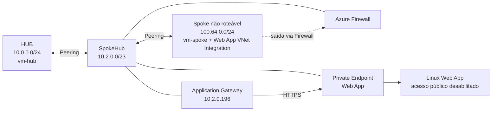
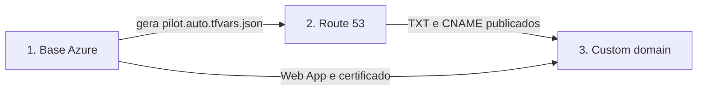

# Laboratório de workload em rede não roteável

Este laboratório demonstra a publicação privada de uma Web App implantada em uma rede não roteável, usando uma topologia `HUB > SpokeHub > Spoke`. O cenário também implementa um pipeline em três partes para registrar e ativar um custom domain cujo DNS público é gerenciado externamente no Amazon Route 53.

O objetivo é permitir a expansão de workloads sem consumir o espaço IPv4 roteável da organização, mantendo os componentes de entrada e saída em uma rede intermediária roteável. O padrão arquitetural é descrito em [Prevent IPv4 exhaustion in Azure](https://learn.microsoft.com/azure/architecture/networking/guide/internet-protocol-version-4-exhaustion).

> [!IMPORTANT]
> Este repositório é um laboratório. A regra `AllowAll` do Azure Firewall, as regras de SSH e os IPs públicos das VMs facilitam os testes, mas devem ser restringidos em um ambiente de produção.

## Arquitetura implantada

A raiz deste diretório é uma configuração Terraform independente e cria os seguintes componentes no Azure:

- Três VNets com peerings bidirecionais entre redes adjacentes:
  - `HUB` (`10.0.0.0/24`), rede roteável;
  - `SpokeHub` (`10.2.0.0/23`), rede roteável que hospeda Azure Firewall, Application Gateway e Private Endpoint;
  - `Spoke` (`100.64.0.0/24`), rede não roteável que hospeda a integração de VNet da Web App.
- Azure Firewall Basic com IPs públicos de dados e gerenciamento. As rotas da subnet de hosts da `Spoke` para os intervalos RFC 1918 e a rota default da subnet da Web App usam o Firewall como próximo salto.
- Application Gateway Standard_v2 com frontend privado `10.2.0.196`, listeners HTTP e HTTPS e backend apontando para o hostname padrão da Web App. Permite o teste do custom domain diretamente no App gateway (ver nota a frente).
- Linux Web App em um App Service Plan P1v3, com acesso público desabilitado, VNet Integration na `Spoke`, todo o tráfego de saída enviado à VNet e Private Endpoint na `SpokeHub`.
- Zona DNS privada `privatelink.azurewebsites.net`, vinculada às três VNets.
- Certificado PFX importado no App Service e carregado no listener HTTPS do Application Gateway.
- Duas VMs Linux de teste: `vm-hub` (`10.0.0.10`) e `vm-spoke` (`100.64.0.10`) que podem ser usadas para os testes de SNAT (VM-spoke para VM-Hub), testes de curl do cliente (VM-hub para Apps) entre outros cenários.



## Pipeline de custom Domain (Apenas Webapp)

O fluxo possui três raízes Terraform e três states independentes. Terraform não carrega automaticamente configurações existentes em subdiretórios.

1. **Base Azure (`./`)**: cria a infraestrutura, importa o PFX e gera `custom-domain/pilot.auto.tfvars.json`.
2. **DNS externo (`./route53`)**: consome explicitamente o JSON de handoff e cria os registros TXT e CNAME em uma hosted zone pública existente no Route 53.
3. **Ativação (`./custom-domain`)**: depois da resolução pública do DNS, cria o custom hostname binding e associa o certificado com SNI à Web App.



O handoff usa `schema_version = 1` e contém:

- nome do resource group, nome e hostname padrão da Web App e ID do certificado;
- custom domain solicitado;
- hosted zone pública;
- registro TXT `asuid.<custom-domain>` com o ID de verificação do App Service;
- registro CNAME do custom domain apontando para o hostname padrão da Web App.

A configuração do Route 53 valida a versão e a origem do handoff e aceita somente registros TXT e CNAME. A etapa de ativação possui ainda o gate explícito `dns_validation_confirmed=true`.

## Pré-requisitos

- Terraform instalado e autenticação ativa no Azure.
- Credenciais AWS com acesso à hosted zone pública no Route 53.
- Permissões AWS equivalentes a `route53:ListHostedZonesByName`, `route53:GetHostedZone`, `route53:ChangeResourceRecordSets` e `route53:GetChange`.
- Hosted zone pública `eroicloud.com.br` já existente. Este laboratório não cria a zona.
- Certificado PFX válido para o valor de `custom_domain_name` e sua senha.
- `dig`, `jq`, `curl` e OpenSSL para inspeção e testes dos exemplos abaixo.

Os defaults atuais usam:

| Variável | Valor padrão |
| --- | --- |
| `resource_group_location` | `centralus` |
| `main_resource_group_name` | `rg-labhub` |
| `workload_name` | `demolab` |
| `custom_domain_name` | `appdemo.eroicloud.com.br` |
| `certificate_pfx_path` | `certs/appdemo.eroicloud.com.br.pfx` |

Para gerar certificados de laboratório com uma CA interna, consulte [cert.md](cert.md). O certificado usado para o binding deve cobrir o custom domain configurado.

## Execução

### 1. Implantar a base Azure

A partir deste diretório, forneça a senha do PFX sem salvá-la em um arquivo `.tfvars` versionado:

```bash
export TF_VAR_certificate_pfx_password='substitua-pela-senha-do-pfx'
terraform init
terraform validate
terraform plan -out=base.tfplan
terraform apply base.tfplan
```

O apply gera `custom-domain/pilot.auto.tfvars.json`. Inspecione o payload que liga as três etapas:

```bash
jq . custom-domain/pilot.auto.tfvars.json
```

> [!WARNING]
> O conteúdo e a senha do PFX são armazenados no state do provider AzureRM, embora a variável seja sensível. Proteja os três states e o JSON gerado, não os envie ao controle de versão e prefira backends remotos protegidos. Para produção, avalie o uso de Key Vault.

### 2. Publicar o DNS no Route 53

O JSON não é carregado automaticamente porque está em outro diretório. Passe-o com `-var-file`:

```bash
cd route53
terraform init
terraform fmt -check
terraform validate
terraform plan \
  -var-file=../custom-domain/pilot.auto.tfvars.json \
  -out=route53.tfplan
terraform apply route53.tfplan
```

O plano deve criar somente os registros TXT e CNAME presentes no handoff. Detalhes de permissões, validação e lifecycle estão em [route53/README.md](route53/README.md).

Espere a propagação e valide os dois registros em um resolvedor público:

```bash
dig TXT asuid.appdemo.eroicloud.com.br @1.1.1.1
dig CNAME appdemo.eroicloud.com.br @1.1.1.1
```

O TXT retornado deve corresponder ao item `app-service-domain-verification` do handoff, e o CNAME deve apontar para o hostname padrão da Web App. Mantenha o TXT enquanto o custom domain estiver em uso para reduzir o risco de subdomain takeover.

Publicar o CNAME não torna a aplicação publicamente acessível, pois `public_network_access_enabled` permanece desabilitado. Nas VNets vinculadas à zona DNS privada, o hostname padrão da Web App resolve para o Private Endpoint.

### 3. Ativar o custom domain

Execute esta etapa somente depois de TXT e CNAME resolverem publicamente:

```bash
cd ../custom-domain
terraform init
terraform validate
terraform plan \
  -var="dns_validation_confirmed=true" \
  -out=custom-domain.tfplan
terraform apply custom-domain.tfplan
```

Essa raiz cria o hostname binding e o certificate binding com `ssl_state = "SniEnabled"`. TLS baseado em IP não é suportado com Private Endpoint do App Service. Consulte também [custom-domain/README.md](custom-domain/README.md).

## Testar o Application Gateway sem DNS privado

O Application Gateway encerra HTTPS para `appdemo.eroicloud.com.br` no frontend privado `10.2.0.196`. A partir de uma máquina com rota até esse IP, converta a CA do laboratório para PEM e use `curl --resolve` para enviar o hostname e o SNI esperados:

```bash
openssl x509 \
  -inform DER \
  -in certs/demolab-root-ca.cer \
  -out /tmp/demolab-root-ca.pem

curl --verbose \
  --cacert /tmp/demolab-root-ca.pem \
  --resolve appdemo.eroicloud.com.br:443:10.2.0.196 \
  https://appdemo.eroicloud.com.br/
```

`--resolve` vale somente para essa chamada do curl e não cria um registro DNS. O Application Gateway encaminha a requisição ao hostname padrão da Web App por HTTPS na porta 443.

## Desmontagem

Como os states são independentes, destrua os componentes na ordem inversa para não manter bindings que apontem para recursos removidos:

```bash
# 1. Binding do custom domain
cd custom-domain
terraform destroy -var="dns_validation_confirmed=true"

# 2. Registros do Route 53, quando também devam ser removidos
cd ../route53
terraform destroy -var-file=../custom-domain/pilot.auto.tfvars.json

# 3. Infraestrutura Azure
cd ..
terraform destroy
```

Antes de destruir a base, preserve o JSON até concluir a remoção das duas raízes consumidoras.

## Considerações de arquitetura

- A faixa `100.64.0.0/10`, compartilhada para Carrier-Grade NAT, permite conservar endereços RFC 1918, mas não deve sobrepor faixas usadas por redes conectadas.
- O limite de [peerings por VNet](https://learn.microsoft.com/azure/azure-resource-manager/management/azure-subscription-service-limits#azure-networking-limits) deve ser considerado ao escalar o padrão.
- O Azure Load Balancer não faz parte deste laboratório. Consulte suas [limitações de backend baseado em IP](https://learn.microsoft.com/azure/load-balancer/backend-pool-management#limitations-for-ip-based-backend-pools) ao avaliar essa alternativa.
- O dimensionamento das subnets depende do serviço e da escala esperada. Consulte a documentação do [Application Gateway](https://learn.microsoft.com/azure/application-gateway/configuration-infrastructure), [SQL Managed Instance](https://learn.microsoft.com/azure/azure-sql/managed-instance/vnet-subnet-determine-size), [Azure Database for PostgreSQL](https://learn.microsoft.com/azure/postgresql/flexible-server/concepts-networking-private) e [Azure Database for MySQL](https://learn.microsoft.com/azure/mysql/flexible-server/concepts-networking-private).
- Private Endpoints ajudam a reduzir o consumo de IPs nas subnets de workloads e mantêm o tráfego privado, mas adicionam custo e dependências de DNS.

## Documentação complementar

- [route53/README.md](route53/README.md): operação da raiz Terraform que publica o DNS externo.
- [custom-domain/README.md](custom-domain/README.md): operação da raiz Terraform que ativa o hostname e o certificado.
- [cert.md](cert.md): geração e validação dos certificados usados no laboratório.
